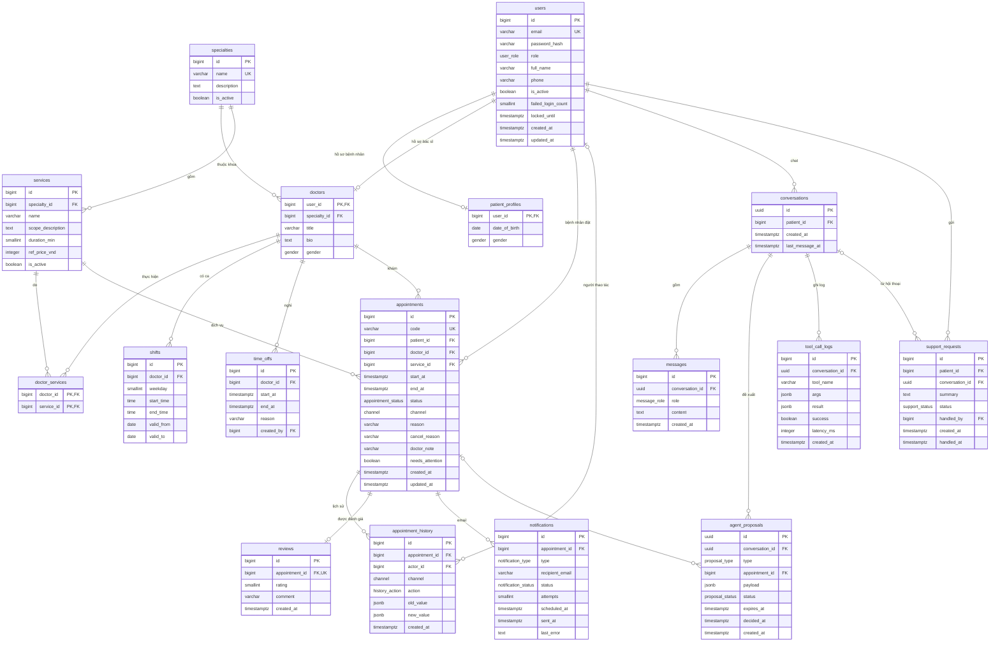

# ERD — Hệ thống đặt lịch khám bệnh tích hợp AI Agent

Oct 10, 2026 · @Viet

## 1. Sơ đồ ERD

Cơ sở dữ liệu PostgreSQL 16 gồm 17 bảng chia 5 nhóm, xoay quanh bảng `appointments`; sơ đồ dưới đây dùng Mermaid nên có thể chép nguyên vào `docs/database/erd.md`, GitHub sẽ tự vẽ.



Ký hiệu: `||` đúng một, `o|` không hoặc một, `o{` không hoặc nhiều. `PK` khóa chính, `FK` khóa ngoại, `UK` duy nhất.

## 2. Danh sách bảng

| Nhóm | Bảng | Mục đích | Số dòng seed (ước tính) |
| --- | --- | --- | --- |
| Người dùng | `users` | Tài khoản đăng nhập chung cho bệnh nhân, bác sĩ, quản trị | \~72 |
| Người dùng | `patient_profiles` | Thông tin riêng của bệnh nhân (1–1 với users) | 50 |
| Người dùng | `doctors` | Thông tin riêng của bác sĩ, thuộc một chuyên khoa | 20 |
| Danh mục | `specialties` | Chuyên khoa | 6 |
| Danh mục | `services` | Dịch vụ khám, có thời lượng và mô tả phạm vi khám cho Agent | \~20 |
| Danh mục | `doctor_services` | Bác sĩ nào thực hiện dịch vụ nào (N–N) | \~60 |
| Lịch làm việc | `shifts` | Ca làm lặp hằng tuần của bác sĩ | \~100 |
| Lịch làm việc | `time_offs` | Ngày/giờ nghỉ, ghi đè lên ca làm | \~10 |
| Lịch hẹn | `appointments` | Lịch hẹn, bảng trung tâm của hệ thống | \~300 |
| Lịch hẹn | `appointment_history` | Nhật ký mọi thay đổi của lịch hẹn | \~400 |
| Lịch hẹn | `reviews` | Đánh giá sau khám (P2) | \~50 |
| Lịch hẹn | `notifications` | Hàng đợi và nhật ký email (P1) | \~600 |
| AI Agent | `conversations` | Phiên chat của bệnh nhân với Agent | sinh khi chạy |
| AI Agent | `messages` | Tin nhắn trong phiên chat | sinh khi chạy |
| AI Agent | `agent_proposals` | Đề xuất đặt/đổi/hủy chờ xác nhận | sinh khi chạy |
| AI Agent | `tool_call_logs` | Log mỗi lần Agent gọi tool, phục vụ đánh giá | sinh khi chạy |
| AI Agent | `support_requests` | Yêu cầu chuyển sang nhân viên | sinh khi chạy |

Số dòng seed `users` = 50 bệnh nhân + 20 bác sĩ + 2 quản trị.

## 3. Quan hệ và quy tắc xóa

Dữ liệu nghiệp vụ không bao giờ bị xóa cứng (dùng `is_active` hoặc trạng thái), nên hầu hết khóa ngoại để `RESTRICT`; chỉ dữ liệu chat là xóa theo hội thoại.

| Quan hệ | Bội số | Khóa ngoại | ON DELETE |
| --- | --- | --- | --- |
| users – patient\_profiles | 1 – 0..1 | patient\_profiles.user\_id | RESTRICT |
| users – doctors | 1 – 0..1 | doctors.user\_id | RESTRICT |
| specialties – doctors | 1 – N | doctors.specialty\_id | RESTRICT |
| specialties – services | 1 – N | services.specialty\_id | RESTRICT |
| doctors – services | N – N | doctor\_services (doctor\_id, service\_id) | CASCADE |
| doctors – shifts | 1 – N | shifts.doctor\_id | CASCADE |
| doctors – time\_offs | 1 – N | time\_offs.doctor\_id | CASCADE |
| users – time\_offs (người tạo) | 0..1 – N | time\_offs.created\_by (NULL = dữ liệu mẫu, hệ thống) | RESTRICT |
| users (bệnh nhân) – appointments | 1 – N | appointments.patient\_id | RESTRICT |
| doctors – appointments | 1 – N | appointments.doctor\_id | RESTRICT |
| services – appointments | 1 – N | appointments.service\_id | RESTRICT |
| appointments – appointment\_history | 1 – N | appointment\_history.appointment\_id | RESTRICT |
| users – appointment\_history | 0..1 – N | appointment\_history.actor\_id (NULL = hệ thống) | SET NULL |
| appointments – reviews | 1 – 0..1 | reviews.appointment\_id (UNIQUE) | RESTRICT |
| appointments – notifications | 1 – N | notifications.appointment\_id | RESTRICT |
| users – conversations | 1 – N | conversations.patient\_id | RESTRICT |
| conversations – messages | 1 – N | messages.conversation\_id | CASCADE |
| conversations – agent\_proposals | 1 – N | agent\_proposals.conversation\_id | CASCADE |
| appointments – agent\_proposals | 0..1 – N | agent\_proposals.appointment\_id | SET NULL |
| conversations – tool\_call\_logs | 1 – N | tool\_call\_logs.conversation\_id | CASCADE |
| users – support\_requests | 1 – N | support\_requests.patient\_id, handled\_by | RESTRICT |
| conversations – support\_requests | 0..1 – N | support\_requests.conversation\_id | SET NULL |

Với `agent_proposals.appointment_id`: đề xuất BOOK để NULL cho tới khi xác nhận thành công thì gán lịch vừa tạo; RESCHEDULE và CANCEL bắt buộc có giá trị ngay từ đầu (ràng buộc CHECK ở mục 5).

## 4. Kiểu enum

Các giá trị cố định được khai báo bằng `CREATE TYPE ... AS ENUM` để database tự từ chối giá trị sai.

| Enum | Giá trị | Dùng ở |
| --- | --- | --- |
| `user_role` | PATIENT, DOCTOR, ADMIN | users.role |
| `gender` | MALE, FEMALE, OTHER | patient\_profiles, doctors |
| `appointment_status` | BOOKED, ARRIVED, COMPLETED, CANCELLED, NO\_SHOW | appointments.status |
| `channel` | WEB, AGENT, ADMIN, SYSTEM | appointments.channel, appointment\_history.channel |
| `history_action` | CREATE, RESCHEDULE, CANCEL, STATUS\_CHANGE, NOTE\_UPDATE, FLAG | appointment\_history.action |
| `notification_type` | BOOKED, RESCHEDULED, CANCELLED, REMINDER | notifications.type |
| `notification_status` | PENDING, SENT, FAILED | notifications.status |
| `message_role` | USER, ASSISTANT, TOOL | messages.role |
| `proposal_type` | BOOK, RESCHEDULE, CANCEL | agent\_proposals.type |
| `proposal_status` | PENDING, CONFIRMED, REJECTED, EXPIRED, FAILED | agent\_proposals.status |
| `support_status` | OPEN, DONE | support\_requests.status |

Tương ứng với SRS: BOOKED = Đã đặt, ARRIVED = Đã đến, COMPLETED = Đã khám, CANCELLED = Đã hủy, NO\_SHOW = Vắng mặt. Kênh ADMIN cho thao tác của quản trị, SYSTEM cho tác vụ nền (ví dụ hết hạn đề xuất).

## 5. Ràng buộc và chỉ mục

Quy tắc quan trọng nhất (BR-01, BR-09: không trùng lịch) được đặt ngay trong database bằng exclusion constraint, nên kể cả hai request chạy đồng thời cũng không thể tạo lịch chồng nhau.

### 5.1 Chống trùng lịch

```sql
CREATE EXTENSION IF NOT EXISTS btree_gist;

ALTER TABLE appointments
  ADD CONSTRAINT ck_appointments_time_order CHECK (end_at > start_at),
  -- BR-01: một bác sĩ không có hai lịch chồng thời gian
  ADD CONSTRAINT excl_doctor_overlap EXCLUDE USING gist (
    doctor_id WITH =,
    tstzrange(start_at, end_at, '[)') WITH &&
  ) WHERE (status IN ('BOOKED', 'ARRIVED')),
  -- BR-09: một bệnh nhân không có hai lịch trùng giờ
  ADD CONSTRAINT excl_patient_overlap EXCLUDE USING gist (
    patient_id WITH =,
    tstzrange(start_at, end_at, '[)') WITH &&
  ) WHERE (status IN ('BOOKED', 'ARRIVED'));
```

Khoảng `[)` cho phép lịch 08:00–08:20 và 08:20–08:40 nằm sát nhau. Khi vi phạm, PostgreSQL trả lỗi `23P01`; backend bắt lỗi này và trả HTTP 409 kèm gợi ý khung khác. Lịch Đã hủy, Vắng mặt, Đã khám không nằm trong điều kiện `WHERE` nên tự động trả lại khung giờ.

### 5.2 Ràng buộc khác

| Bảng | Ràng buộc | Lý do |
| --- | --- | --- |
| users | `UNIQUE (lower(email))` | Email không trùng, không phân biệt hoa thường |
| services | `CHECK (duration_min BETWEEN 10 AND 120 AND duration_min % 5 = 0)`, `CHECK (ref_price_vnd >= 0)`, `UNIQUE (specialty_id, name)` | FR-CAT-02 |
| shifts | `CHECK (weekday BETWEEN 1 AND 7)`, `CHECK (end_time > start_time)`, `CHECK (valid_to IS NULL OR valid_to >= valid_from)` | Ca hợp lệ; ca chồng ca kiểm tra ở tầng service |
| time\_offs | `CHECK (end_at > start_at)` |  |
| appointments | `UNIQUE (code)` | Mã lịch hẹn `LH-YYMMDD-XXXX` |
| reviews | `UNIQUE (appointment_id)`, `CHECK (rating BETWEEN 1 AND 5)` | Một đánh giá mỗi lịch |
| notifications | `UNIQUE (appointment_id, type) WHERE type = 'REMINDER'` | Mỗi lịch chỉ nhắc một lần (FR-NTF-02) |
| agent\_proposals | `CHECK (type = 'BOOK' OR appointment_id IS NOT NULL)` | Đổi/hủy phải chỉ rõ lịch nào |

Tên ràng buộc theo quy ước của `backend/app/db/base.py`: `ck_<bảng>_<tên>`, `uq_<bảng>_<các cột>`, `fk_<bảng>_<cột>_<bảng đích>`; riêng hai exclusion constraint giữ tên ở mục 5.1 vì backend dựa vào tên để trả `SLOT_TAKEN`, `PATIENT_OVERLAP`.

Các quy tắc phụ thuộc thời điểm hiện tại (mốc 2 giờ, cửa sổ 30 ngày, tối đa 3 lịch đang chờ) không đặt bằng CHECK vì `now()` thay đổi; chúng kiểm tra ở tầng service trong cùng transaction.

### 5.3 Chỉ mục

| Chỉ mục | Phục vụ |
| --- | --- |
| `appointments (doctor_id, start_at)` | Tính khung trống, lịch khám bác sĩ |
| `appointments (patient_id, start_at DESC)` | Lịch của tôi |
| `appointments (start_at) WHERE needs_attention` | Hàng chờ cần xử lý của quản trị |
| `shifts (doctor_id, weekday)` | Tính khung trống |
| `time_offs (doctor_id, start_at)` | Tính khung trống |
| `appointment_history (appointment_id, created_at)` | Xem lịch sử thay đổi |
| `notifications (scheduled_at) WHERE status = 'PENDING'` | Tác vụ nền gửi email |
| `agent_proposals (expires_at) WHERE status = 'PENDING'` | Tác vụ nền hết hạn đề xuất |
| `messages (conversation_id, created_at)` | Tải lịch sử chat |
| `tool_call_logs (conversation_id, created_at)`, `(tool_name)` | Đánh giá Agent |
| `agent_proposals (conversation_id)`, `support_requests (conversation_id)` | Job xóa hội thoại cũ (CASCADE, SET NULL) không quét cả bảng |

Tìm kiếm không dấu (FR-CAT-04) dùng extension `unaccent` với `ILIKE`; với khoảng 20 dịch vụ và 20 bác sĩ thì chưa cần chỉ mục trigram.

## 6. Quyết định thiết kế

| Quyết định | Lý do |
| --- | --- |
| Một bảng `users` cho cả 3 vai trò, thông tin riêng tách sang bảng hồ sơ 1–1 | Một cơ chế đăng nhập và phân quyền; bảng hồ sơ không có cột thừa |
| Không lưu bảng khung giờ (slot) | Khung trống tính động từ ca làm − ngày nghỉ − lịch hẹn, không phải đồng bộ khi quản trị sửa ca |
| Lịch hẹn lưu cả `start_at` và `end_at` | Exclusion constraint cần khoảng thời gian; đổi thời lượng dịch vụ sau này không làm sai lịch cũ |
| Đổi lịch là UPDATE trên cùng dòng | Giữ nguyên mã lịch hẹn (UC06); giá trị cũ nằm trong `appointment_history` |
| UUID cho `conversations` và `agent_proposals`, bigint cho bảng còn lại | Hai id này lộ ra giao diện và thẻ xác nhận, nên không được đoán được |
| `jsonb` cho payload đề xuất, tham số tool, giá trị cũ/mới | Cấu trúc thay đổi theo loại thao tác; chỉ dùng để thực thi đề xuất, ghi log và hiển thị |
| `reviews` không lưu `doctor_id` | Suy ra qua lịch hẹn, tránh hai nguồn dữ liệu lệch nhau |
| Không có bảng refresh token | JWT không trạng thái là đủ cho đồ án; nếu cần thu hồi token sẽ thêm sau |

### Điểm khác so với SRS 1.0

ERD bổ sung một số chi tiết khi thiết kế ở mức bảng; SRS mục 6.1 cần cập nhật theo:

- Thêm bảng `notifications` (P1) để xếp hàng và thử lại email theo FR-NTF-02, 03, nên có 17 bảng thay vì 16 thực thể.
- Thêm cột `users.failed_login_count`, `users.locked_until` cho FR-AUTH-03; `appointments.cancel_reason` cho FR-APT-03; `time_offs.created_by`.
- Enum `channel` có thêm ADMIN và SYSTEM ngoài WEB, AGENT, để nhật ký phân biệt thao tác của quản trị và tác vụ nền.
- `agent_proposals` không lưu `patient_id`; bệnh nhân được xác định qua hội thoại.
